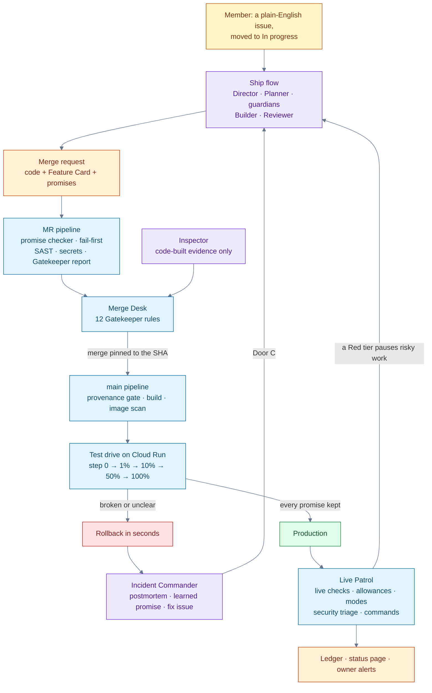

# Vallum

**A hands-off release guardian on the GitLab Duo Agent Platform and Google Cloud.**

Vallum ships a requested feature to production by itself, but only if the feature keeps its promises, and only
as boldly as its mistake allowance permits. Agents write code, promises and explanations; code decides what ships.

Vallum was built for the GitLab Transcend "Life After Code" hackathon (Path A, Hands-off).

## Demo and presentation

| Resource | Link |
|---|---|
| Demo video (3 minutes) | *To be added.* <!-- Replace "*To be added.*" with the video link, for example: [Watch the demo](https://www.youtube.com/watch?v=...) --> |
| Presentation slides (PDF) | *To be added.* <!-- Upload the PDF as docs/Vallum-slides.pdf, then replace "*To be added.*" with: [Vallum-slides.pdf](docs/Vallum-slides.pdf) --> |

## About this repository

This GitHub repository is a copy of the
[GitLab project](https://gitlab.com/gitlab-ai-hackathon/transcend-october-2026/43503198/vallum) on which Vallum
ran live and was judged. The hackathon group was archived after the submission deadline, so that project is now a
read-only archive: nothing has run there since 27 October 2026, and no one, including the owner, can trigger it.

| Objective | Where to go |
|---|---|
| Review the recorded runs | Browse or clone the archive of every real run: [pipelines](https://gitlab.com/gitlab-ai-hackathon/transcend-october-2026/43503198/vallum/-/pipelines), [merge requests built by agents](https://gitlab.com/gitlab-ai-hackathon/transcend-october-2026/43503198/vallum/-/merge_requests?state=merged), [incident #5 and its learned promise](https://gitlab.com/gitlab-ai-hackathon/transcend-october-2026/43503198/vallum/-/work_items/5), and the [Ledger](https://gitlab.com/gitlab-ai-hackathon/transcend-october-2026/43503198/vallum/-/work_items/3). The deployed [app](https://vallum-256944994567.us-central1.run.app/) and [control room](https://vallum-status-256944994567.us-central1.run.app/) remain available through the judging period (ending 14 November 2026) and at least until 20 January 2027; their state is frozen as of 27 October 2026. |
| Run it locally (about five minutes) | [Run it locally](#run-it-locally): the 231 tests, the app and the control room, with no cloud services required. |
| Run the full loop live | [SETUP.md](SETUP.md): this now requires your own GitLab project (with the Duo Agent Platform) and your own Google Cloud project. |

## Live resources

- **The app**, a small link shortener on Google Cloud Run: <https://vallum-256944994567.us-central1.run.app/>
- **The control room**, Vallum's status site, deployed as a separate Cloud Run service:
  <https://vallum-status-256944994567.us-central1.run.app/>. It has one page per topic:
  [releases](https://vallum-status-256944994567.us-central1.run.app/releases), with a live lane for the release
  being test-driven; [features](https://vallum-status-256944994567.us-central1.run.app/features), shown as cards
  with their promises; the [mistake allowance](https://vallum-status-256944994567.us-central1.run.app/allowance);
  [security](https://vallum-status-256944994567.us-central1.run.app/security); and
  [rules and code](https://vallum-status-256944994567.us-central1.run.app/rules), which holds read-only copies of
  the Rulebook, the policy and the code map.
- **The Ledger**, Vallum's state, rewritten by code:
  [issue #3](https://gitlab.com/gitlab-ai-hackathon/transcend-october-2026/43503198/vallum/-/work_items/3)
- **Pipelines**, every run public:
  [pipelines](https://gitlab.com/gitlab-ai-hackathon/transcend-october-2026/43503198/vallum/-/pipelines)

## Project status

At the end of the hackathon (27 October 2026), all four layers were built and running live. Layers 1 to 3
passed their live tests between 21 and 25 October, and the final end-to-end run shipped issue #20 with zero
human steps.

| Layer | Scope |
|---|---|
| 1 | The safe skeleton: promise checker, Gatekeeper, Merge Desk, deploy provenance gate, test drive on Cloud Run, state store, Notifier, Watchdog and visitor simulation |
| 2 | The agents: GitLab Duo flows published from this repository, with code still deciding what ships |
| 3 | Judgment: mistake allowances and modes, scoped freezes, `@vallum` commands, needs-human escalation, and project context that works for any codebase |
| 4 | The public status page with a live release lane, image scanning judged before release, security triage and kill switches |

## How it works



Purple boxes are agents: they write code, promises and explanations. Blue boxes are code: they decide what
merges, what ships, how far, and when to roll back. No agent can merge, deploy or move traffic.

## The nine stages and the decision Vallum makes in each

Every row links to a real run on the GitLab project.

| Stage | Decision | Made by | Evidence |
|---|---|---|---|
| **Plan** | Accept, pause or refuse a request; set the tier, priority and Feature Card; turn incidents into P0 fix issues | Flight Director, Planner, priority code | [#7 paused while Core was Red](https://gitlab.com/gitlab-ai-hackathon/transcend-october-2026/43503198/vallum/-/work_items/7) · [#6 P0 fix from an incident](https://gitlab.com/gitlab-ai-hackathon/transcend-october-2026/43503198/vallum/-/work_items/6) · [Ledger queue](https://gitlab.com/gitlab-ai-hackathon/transcend-october-2026/43503198/vallum/-/work_items/3) |
| **Create** | Code and tests are written and reviewed against the Rulebook and the card; doubts become watch promises | Builder, Reviewer, GitLab Duo Code Review | [!14 link preview, built by agents](https://gitlab.com/gitlab-ai-hackathon/transcend-october-2026/43503198/vallum/-/merge_requests/14) · [!5 Duo's requested changes answered in fix mode](https://gitlab.com/gitlab-ai-hackathon/transcend-october-2026/43503198/vallum/-/merge_requests/5) |
| **Verify** | Promises are judged on a localhost copy; fail-first; broken pipelines are repaired; the Inspector checks the work against the request | Promise checker, Pipeline Medic, Inspector | [!13 Medic repair, Inspector "matches", 12/12](https://gitlab.com/gitlab-ai-hackathon/transcend-october-2026/43503198/vallum/-/merge_requests/13) · [!18 refused at 11/12 on the Inspector's "gaps"](https://gitlab.com/gitlab-ai-hackathon/transcend-october-2026/43503198/vallum/-/merge_requests/18) |
| **Package** | The image is built, copied to the project registry and scanned; step 0 judges its size and its fixable critical findings before any visitor sees it | Build job, GitLab container scanning, test drive | [Main pipeline with build and container scan](https://gitlab.com/gitlab-ai-hackathon/transcend-october-2026/43503198/vallum/-/pipelines/2986328366) |
| **Secure** | SAST, secret detection and container scanning; new high or critical findings block merges (rule 8); every open finding receives a decision by code | Gatekeeper, security triage, Security guardian | [Ledger: security findings](https://gitlab.com/gitlab-ai-hackathon/transcend-october-2026/43503198/vallum/-/work_items/3) · [Control room: Security](https://vallum-status-256944994567.us-central1.run.app/security) |
| **Release** | Step up or roll back at each test-drive step; write release notes; close requests once live | Test-drive controller (code), Release Captain | [r-0012: step 0 replay, 1% → 10% → 50% → 100%](https://gitlab.com/gitlab-ai-hackathon/transcend-october-2026/43503198/vallum/-/pipelines/2985841685) · [r-0006 rolled back at 1%](https://gitlab.com/gitlab-ai-hackathon/transcend-october-2026/43503198/vallum/-/work_items/5) |
| **Configure** | Traffic split per step; Cloud Run settings as code; emergency rollback | Test-drive controller, `rollback-now` | [`deploy/service.yaml`](deploy/service.yaml) · [`rollback-now` run that tripped the circuit breaker](https://gitlab.com/gitlab-ai-hackathon/transcend-october-2026/43503198/vallum/-/jobs/17444987185) |
| **Monitor** | Live promises are judged on every patrol; allowances are spent; modes change; incidents, postmortems and learned promises are produced | Live Patrol, Incident Commander, Notifier | [Incident #5 and learned promise !12](https://gitlab.com/gitlab-ai-hackathon/transcend-october-2026/43503198/vallum/-/work_items/5) · [Control room](https://vallum-status-256944994567.us-central1.run.app/) |
| **Govern** | 12 Gatekeeper rules; one merge path; provenance gate; circuit breaker; every override recorded | Gatekeeper, Merge Desk, provenance gate, Watchdog | [An unsanctioned push stopped](https://gitlab.com/gitlab-ai-hackathon/transcend-october-2026/43503198/vallum/-/pipelines/2986301320) · [!17 merged at 12/12 by the Merge Desk](https://gitlab.com/gitlab-ai-hackathon/transcend-october-2026/43503198/vallum/-/merge_requests/17) |

## The agents (Layer 2)

| Flow (`.gitlab/duo/flows/`) | Started by | Responsibilities | Restrictions |
|---|---|---|---|
| **Ship** (`ship.yaml`) | Door A: a member moves a Feature issue to *In progress*. Door B: a member adds the Ship bot as a reviewer. The Merge Desk also adds it as a reviewer for a review or fix round. | The Flight Director supervises the Planner, four guardians (behavior, speed, reliability, security), the Builder and the Reviewer; opens the merge request; pauses when the tier is Red; asks for a human when needed | Cannot merge, deploy or modify protected paths |
| **Inspector** (`inspect.yaml`) | The Merge Desk, through the Flows API | Checks the work against the request, using only a code-built evidence bundle | Cannot use any tool; its verdict is read by code from the session |
| **Pipeline Medic** (`medic.yaml`) | The Merge Desk assigns its bot as a reviewer when a merge request pipeline fails (at most twice) | Reads the actual job logs and fixes the cause | Cannot change promises |
| **Release Captain** (`release.yaml`) | The test drive assigns its bot to the request after a promotion | Writes release notes from the release record and closes the request issue | Cannot decide anything |
| **Incident Commander** (`incident.yaml`) | The test drive or Live Patrol assigns its bot to the incident issue | Writes the postmortem, the learned-promise merge request and a fix issue, which is then built automatically (Door C) | Cannot edit existing files |
| **Cockpit** (`cockpit.yaml`) | A user mentions its bot | Explains Vallum's state and turns plain requests into exact `@vallum` commands | Cannot carry anything out |

Code starts agents through member-only actions (assigning a flow's bot, or moving an issue to *In progress*)
using the owner's account, so each flow runs on its own service account. Its credits still count against the
member whose action started it, as measured on 24 October. The Flows API is used only for the Inspector and as a
fallback. A daily cap on code-started sessions turns Safe mode on (the credit guard). The `flows-sync` job
publishes the YAML to the AI Catalog, enables each flow, keeps its triggers exactly as `vallum/flows/` lists
them, and records each bot account. Verdicts count only when they come from the correct bot (the Reviewer) or
from the Inspector's own session trace. GitLab Duo Code Review runs on every merge request with instructions
generated from the Rulebook (`.gitlab/duo/mr-review-instructions.yaml`). Each role's know-how is in
`skills/<role>/SKILL.md`.

## Release process (Layer 1)

1. A project member opens a merge request with a Feature Card in `promises/features/` and adds the label `vallum`.
2. The **merge request pipeline** (no tokens, no cloud access) runs the unit tests, the **promise checker** on a
   localhost copy of the app with the Firestore emulator (including the *fail-first* check: new behavior promises
   must fail on `main` and pass on the branch), SAST, secret detection and the **Gatekeeper report**.
3. The **Merge Desk** (a job on `main` with `resource_group: release`, run every 5 minutes and at the end of every
   main pipeline) picks the next ready merge request by priority, rebases it, waits for a fresh pipeline on that
   exact commit, runs all **12 Gatekeeper rules**, records the commit as sanctioned, gives the owner's approval
   that the merge request approval rule requires, and merges pinned to that SHA.
4. The **main pipeline** starts with the **deploy provenance gate**, which refuses commits that skipped the Merge
   Desk. A push is judged by the policy on `main` from before the push, so no push can rewrite the rule that
   judges it. The pipeline then builds the image into Artifact Registry and runs the **test drive** on Cloud Run:
   deploy with 0% traffic, run step 0 on the private address, then apply the tier's traffic steps (Standard:
   10% → 50% → 100%) while simulated visitors play the users. Kept promises mean promotion; a broken or unclear
   result means an **immediate rollback**. Every visit names the revision that served it, and promotions and
   rollbacks are confirmed on the live app (15 consecutive answers from the target revision), because Cloud Run
   can report a new traffic split up to several minutes after applying it.
5. The **Notifier** keeps one live status comment on the merge request, alerts the change owner, and mirrors the
   state store into the **Ledger** issue. The **Watchdog** undoes anything left half-done, immediately if the
   test-drive job has already ended.

In an emergency, run the manual job **`rollback-now`** in any `main` pipeline.

## Judgment and controls (Layer 3)

- **Mistake allowance and modes.** Every test-drive step and every Live Patrol run (a 30-second burst of
  simulated visitors) counts good and bad visits per tier. A visit is bad if it failed or was slower than twice
  the route's speed limit; a broken live behavior promise spends 5% of the allowance. Core turns Red below 50%
  and returns to Green above 65%. Standard has Yellow (an extra test-drive step and a size cap) and Red.
  Experimental is always Green.
- **Scoped freeze.** A change touching a Red tier is paused (merge requests by the Merge Desk, issues by the
  Flight Director), and its owner is told why. It resumes automatically when the tier recovers. P0 and P1 fixes
  still ship.
- **Human escalation.** The Reviewer can answer `needs-human` with the decision required and the options; code
  stops all agent work on that merge request, labels it `vallum::needs-human` and alerts the owner. Removing the
  label resumes the work.
- **Commands.** Commands are available to members only, carried out by code, and audited. The first command runs
  on the next Live Patrol (within about 10 minutes); after that, listen mode answers follow-up commands within
  about 15 seconds for 20 minutes. Selecting the Cockpit bot from the `@vallum` autocomplete also returns an
  immediate acknowledgement.

  | Comment | Effect |
  |---|---|
  | `@vallum status` | Reports modes, allowances, the current release and the queue |
  | `@vallum pause` / `@vallum resume` | Turns Safe mode on or off (resume also resets the circuit breaker) |
  | `@vallum rollback <feature>` | Moves traffic back to the revision before that feature's release |
  | `@vallum ship-anyway !<n>` | Overrides a freeze for one merge request (recorded) |
  | `@vallum tighten <promise-id> <limit>` | Opens a merge request that makes a limit stricter |
  | `@vallum explain !<n>` | Asks the Cockpit agent for a plain-English explanation |
  | `@vallum listen <minutes>` / `@vallum listen off` | Keeps code checking for commands every 15 seconds (for a test or demonstration session) |

## Project context for any codebase

Vallum's code and skills contain no project-specific details. Each codebase provides its own:

| File | Written by | Contents | Protected |
|---|---|---|---|
| `vallum/project.yaml` | Owner | Language, layout, where features and tests go, start and test commands | Yes |
| `docs/vallum/GUIDELINES.md` | Owner | Conventions, limits, examples of good promises | Yes |
| `docs/vallum/roles/<role>.md` | Owner | Optional notes for one agent role | Yes |
| `docs/vallum/CODEMAP.md` | Code (`python -m vallum.codemap`) | Every module, route, Feature Card and test; refreshed by a housekeeping merge request after each release | Yes |

Every agent reads the guidelines, the code map and its role notes before acting. The code map generator reads
Python by AST and JavaScript, TypeScript, Go and Java by pattern (see the Express fixture in `tests/fixtures/`).

## Repository structure

| Path | Contents |
|---|---|
| `app/` | FastAPI link shortener; one module per feature in `app/features/` (home page, links, redirects and others); its styling in `app/ui.py` |
| `control/` (protected) | The control room: Vallum's status site, deployed from the same image to its own service (`vallum-status`) by the `control-room` job; reads only public state |
| `promises/` | Feature Cards, app-wide promises (`service.yaml`) and learned promises |
| `vallum/` (protected) | Rulebook, policy, catalog, card schema and all of Vallum's code |
| `vallum/checker/` | Promise checker (steps, measure, static, scan) and fail-first check |
| `vallum/gate/` | Gatekeeper (12 rules) and provenance gate |
| `vallum/desk/` | Merge Desk |
| `vallum/drive/` | Test-drive controller (Cloud Run REST API, keyless login) |
| `vallum/patrol/` | Live Patrol (live checks, allowances, resumes, Door C, commands) and Watchdog |
| `vallum/allowance.py` | Mistake allowance and modes |
| `vallum/cockpit.py` | `@vallum` commands, parsed and carried out by code |
| `vallum/agents.py` | Starts agents through member-only actions; credit guard |
| `vallum/codemap/`, `vallum/housekeeping.py` | Code map generator; post-release housekeeping merge request |
| `vallum/notify/` | Status comments, alerts and the Ledger |
| `vallum/public.py` | The public summary shown by the control room (written by code, no secrets) |
| `vallum/security.py` | Security triage: a decision by code for every open scanner finding |
| `vallum/flows/` | Publishes the flows and maintains their triggers |
| `vallum/evidence/` | Evidence bundle for the Inspector (primary data only) |
| `skills/` (protected) | Know-how for each agent role (project-neutral) |
| `docs/vallum/` (protected) | This project's guidelines, role notes and generated code map |
| `simulate/` | Visitor simulation run by CI jobs |
| `deploy/service.yaml` | Cloud Run settings as code |

Protected paths can be changed only by the owner; the Gatekeeper refuses changes from anyone else.

## Google Cloud

Vallum uses Cloud Run (the app, and the control room as a separate service; revisions, tags, traffic splitting,
minimum instances set to 0), Artifact Registry, Firestore (app data and the state store), and Workload Identity
Federation from protected `main` pipelines only. No key files exist. Visitors were simulated by CI jobs during the
hackathon; nothing runs on Google Cloud between test drives.

## Run it locally

No Google Cloud or GitLab access is needed: the app and the control room use an in-memory store
(`APP_STORE=memory`). The variables are also listed in [`.env.example`](.env.example). Python 3.12 is required.

```bash
python -m venv .venv
source .venv/bin/activate            # Windows: .venv\Scripts\activate
pip install -r requirements.txt -r requirements-vallum.txt
pytest                               # 231 tests
```

Start the app (the link shortener) on <http://127.0.0.1:8000>:

```bash
APP_STORE=memory APP_API_KEY=dev CONTROL_ROOM_URL=http://127.0.0.1:8001 \
  uvicorn app.main:app --port 8000 --reload
```

Create a link and follow it (write endpoints require the key in the `X-API-Key` header):

```bash
curl -X POST http://127.0.0.1:8000/api/links -H "X-API-Key: dev" \
  -H "Content-Type: application/json" -d '{"url": "https://example.com"}'
curl -i http://127.0.0.1:8000/r/<code>    # 302 to https://example.com
```

Start the control room on <http://127.0.0.1:8001> in a second terminal. With an empty in-memory store, its pages
render without releases or history; on Cloud Run, it reads Vallum's state store.

```bash
APP_STORE=memory APP_URL=http://127.0.0.1:8000 uvicorn control.main:app --port 8001
```

With Docker, one image runs either service (`APP_MODULE` selects it; the container listens on port 8080):

```bash
docker build -t vallum .
docker run --rm -p 8000:8080 -e APP_STORE=memory -e APP_API_KEY=dev \
  -e CONTROL_ROOM_URL=http://127.0.0.1:8001 vallum
docker run --rm -p 8001:8080 -e APP_STORE=memory -e APP_MODULE=control.main:app \
  -e APP_URL=http://127.0.0.1:8000 vallum
```

Kill switches can be turned off locally with `APP_FLAGS_OFF`, for example `APP_FLAGS_OFF=custom_alias,link_preview`.

## License

This project is released under the [MIT License](LICENSE).
