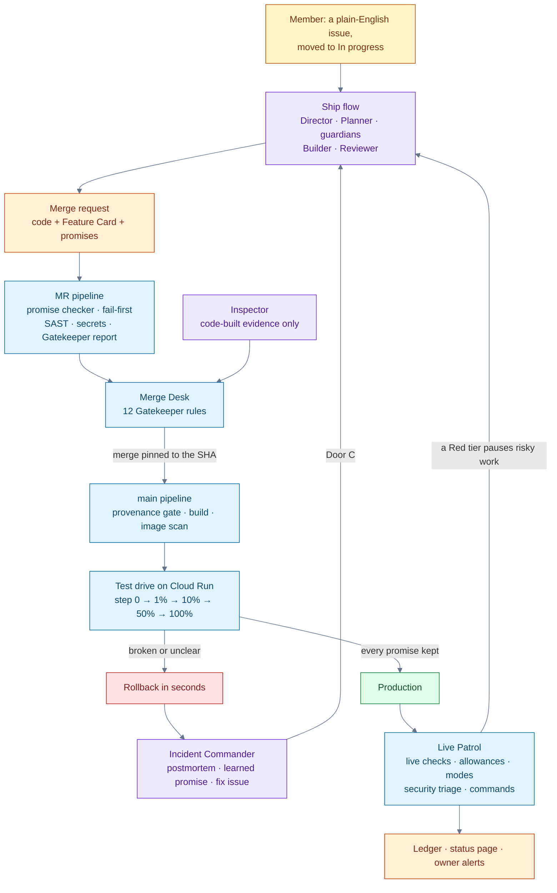

# 🛡 Vallum

**A hands-off release guardian on GitLab Duo Agent Platform.** Vallum ships a requested feature to
production by itself, but only if the feature keeps its promises, and only as boldly as its mistake
allowance permits. Agents write code, promises and explanations; **code decides what ships**.

Built for the GitLab Transcend "Life After Code" hackathon (Path A, Hands-off).

- **Live status page** (Google Cloud Run): <https://vallum-256944994567.us-central1.run.app/status>
- **The Ledger** (Vallum's state, rewritten by code): [issue #3](https://gitlab.com/gitlab-ai-hackathon/transcend-october-2026/43503198/vallum/-/work_items/3)
- **Every run, in the open**: [pipelines](https://gitlab.com/gitlab-ai-hackathon/transcend-october-2026/43503198/vallum/-/pipelines)

> Status: **Layers 1–3 passed live** (21–25 Oct), Layer 4 in progress. Layer 1 is the safe skeleton (promise
> checker, Gatekeeper, Merge Desk, deploy provenance gate, test drive on Cloud Run, state store, Notifier,
> Watchdog, visitor simulation). Layer 2 adds the agents: GitLab Duo flows published from this repo, with code
> still deciding what ships. Layer 3 adds judgment (mistake allowances and modes, scoped freezes, `@vallum`
> commands, needs-human escalation) and project context that works for any codebase. Layer 4 adds the public
> status page, image scanning judged before release, and security triage.

## How it works



Purple boxes are agents: they write code, promises and explanations. Blue boxes are code: they decide what
merges, what ships, how far, and when to roll back. No agent can merge, deploy or move traffic.

## The nine stages: the decision Vallum makes in each

Every row links to a real run on this project.

| Stage | Decision | Made by | See it |
|---|---|---|---|
| **Plan** | Accept, pause or refuse a request; tier, priority and Feature Card; incidents become P0 fix issues | Flight Director, Planner, priority code | [#7 paused while Core was Red](https://gitlab.com/gitlab-ai-hackathon/transcend-october-2026/43503198/vallum/-/work_items/7) · [#6 P0 fix from an incident](https://gitlab.com/gitlab-ai-hackathon/transcend-october-2026/43503198/vallum/-/work_items/6) · [Ledger queue](https://gitlab.com/gitlab-ai-hackathon/transcend-october-2026/43503198/vallum/-/work_items/3) |
| **Create** | Code and tests written; reviewed against the Rulebook and the card; doubts become watch promises | Builder, Reviewer, GitLab Duo Code Review | [!14 link preview, built by agents](https://gitlab.com/gitlab-ai-hackathon/transcend-october-2026/43503198/vallum/-/merge_requests/14) · [!5 Duo's requested changes answered in fix mode](https://gitlab.com/gitlab-ai-hackathon/transcend-october-2026/43503198/vallum/-/merge_requests/5) |
| **Verify** | Promises judged on a localhost copy; fail-first; broken pipelines repaired; the Inspector checks the work against the request | Promise checker, Pipeline Medic, Inspector | [!13 Medic repair, Inspector "matches", 12/12](https://gitlab.com/gitlab-ai-hackathon/transcend-october-2026/43503198/vallum/-/merge_requests/13) · [!18 refused 11/12 on the Inspector's "gaps"](https://gitlab.com/gitlab-ai-hackathon/transcend-october-2026/43503198/vallum/-/merge_requests/18) |
| **Package** | Image built, copied to the project registry and scanned; step 0 judges its size and its fixable criticals before any visitor | Build job, GitLab container scanning, test drive | [main pipeline with build and container scan](https://gitlab.com/gitlab-ai-hackathon/transcend-october-2026/43503198/vallum/-/pipelines/2986328366) |
| **Secure** | SAST, secret detection and container scanning; new high or critical findings block merges (rule 8); every open finding gets a decision by code | Gatekeeper, security triage, Security guardian | [Ledger: security findings](https://gitlab.com/gitlab-ai-hackathon/transcend-october-2026/43503198/vallum/-/work_items/3) · [status page: Security](https://vallum-256944994567.us-central1.run.app/status) |
| **Release** | Step up or roll back at each test-drive step; release notes; requests closed when live | Test-drive controller (code), Release Captain | [r-0012: step 0 replay, 1% → 10% → 50% → 100%](https://gitlab.com/gitlab-ai-hackathon/transcend-october-2026/43503198/vallum/-/pipelines/2985841685) · [r-0006 rolled back at 1%](https://gitlab.com/gitlab-ai-hackathon/transcend-october-2026/43503198/vallum/-/work_items/5) |
| **Configure** | Traffic split per step; Cloud Run settings as code; emergency rollback | Test-drive controller, `rollback-now` | [`deploy/service.yaml`](deploy/service.yaml) · [`rollback-now` run that tripped the circuit breaker](https://gitlab.com/gitlab-ai-hackathon/transcend-october-2026/43503198/vallum/-/jobs/17444987185) |
| **Monitor** | Live promises judged every patrol; allowances spent; modes changed; incidents, postmortems and learned promises | Live Patrol, Incident Commander, Notifier | [incident #5 → learned promise !12](https://gitlab.com/gitlab-ai-hackathon/transcend-october-2026/43503198/vallum/-/work_items/5) · [status page](https://vallum-256944994567.us-central1.run.app/status) |
| **Govern** | 12 Gatekeeper rules; one merge path; provenance gate; circuit breaker; every override recorded | Gatekeeper, Merge Desk, provenance gate, Watchdog | [an unsanctioned push stopped](https://gitlab.com/gitlab-ai-hackathon/transcend-october-2026/43503198/vallum/-/pipelines/2986301320) · [!17 merged 12/12 by the desk](https://gitlab.com/gitlab-ai-hackathon/transcend-october-2026/43503198/vallum/-/merge_requests/17) |

## The agents (Layer 2)

| Flow (`.gitlab/duo/flows/`) | Starts on | Does | Can't |
|---|---|---|---|
| **Ship** (`ship.yaml`) | Door A: a member moves a Feature issue to *In progress*. Door B: a member adds the Ship bot as reviewer. The Merge Desk adds it as reviewer for a review or fix round | Flight Director supervises Planner, four guardians (behavior, speed, reliability, security), Builder and Reviewer; opens the MR; pauses when the tier is Red; asks for a human when needed | merge, deploy, touch protected paths |
| **Inspector** (`inspect.yaml`) | Merge Desk, through the Flows API | Checks the work against the request from a code-built evidence bundle only | use any tool; its verdict is read by code from the session |
| **Pipeline Medic** (`medic.yaml`) | Merge Desk assigns its bot as reviewer when an MR pipeline fails (max 2) | Reads the real job logs and fixes the cause | change promises |
| **Release Captain** (`release.yaml`) | Test drive assigns its bot to the request after a promotion | Release notes from the release record; closes the request issue | decide anything |
| **Incident Commander** (`incident.yaml`) | Test drive or Live Patrol assigns its bot to the incident issue | Postmortem, learned-promise MR, fix issue (built by itself: Door C) | edit existing files |
| **Cockpit** (`cockpit.yaml`) | Someone mentions its bot | Explains, and turns plain requests into exact `@vallum` commands | carry anything out |

Code starts agents by **member-only actions** (assigning a flow's bot, moving an issue to *In progress*) with
the owner's account, so each flow runs on its own service account (its credits still count against the member
whose action fired it, as measured on 24 Oct); the Flows API is used only for the Inspector and as a fallback. A daily cap on code-started sessions turns Safe
mode on (credit guard). The `flows-sync` job publishes the YAML to the AI Catalog, enables each flow, keeps
its triggers exactly as `vallum/flows/` lists them and records each bot account. Verdicts only count from the
right bot (Reviewer) or from the Inspector's own session trace.
GitLab Duo Code Review runs on every MR with instructions generated from the Rulebook
(`.gitlab/duo/mr-review-instructions.yaml`). Each role's know-how is in `skills/<role>/SKILL.md`.

## How a change ships today (Layer 1)

1. A project member opens a merge request with a Feature Card in `promises/features/` and adds the label `vallum`.
2. The **MR pipeline** (no tokens, no cloud access) runs the unit tests, the **promise checker** on a localhost copy
   of the app with the Firestore emulator (including the *fail-first* check: new behavior promises must fail on
   `main` and pass on the branch), SAST, secret detection and the **Gatekeeper report**.
3. The **Merge Desk** (a job on `main`, `resource_group: release`, every 5 minutes and at the end of every main
   pipeline) picks the next ready MR by priority, rebases it, waits for a fresh pipeline on that exact commit,
   runs all **12 Gatekeeper rules**, records the commit as sanctioned, gives the owner's approval that the MR
   approval rule needs, and merges pinned to that SHA.
4. The **main pipeline** starts with the **deploy provenance gate** (refuses commits that skipped the Merge Desk;
   a push is judged by `main`'s policy from before it, so no push can rewrite the rule that judges it),
   builds the image into Artifact Registry and runs the **test drive** on Cloud Run: deploy with 0% traffic, step 0
   on the private address, then the tier's traffic steps (Standard: 10% → 50% → 100%) while simulated visitors
   play the users. Kept means promote; broken or unclear means **instant rollback**. Every visit names the
   revision that served it, and promotions and rollbacks are confirmed on the live app (15 answers in a row from
   the target revision), because Cloud Run reports a new split up to minutes after it applies it.
5. The **Notifier** keeps one live status comment on the MR, alerts the change owner, and mirrors the state
   store into the **Ledger** issue. The **Watchdog** undoes anything left half-done, at once if the test-drive
   job has already ended.

Emergency: run the manual job **`rollback-now`** in any `main` pipeline.

## Judgment and controls (Layer 3)

- **Mistake allowance and modes.** Every test-drive step and every Live Patrol run (a 30-second burst of
  simulated visitors) counts good and bad visits per tier. Bad = failed, or slower than twice the route's speed
  limit; a broken live behavior promise spends 5%. Core goes Red under 50% and back to Green over 65%;
  Standard has Yellow (an extra test-drive step, a size cap) and Red. Experimental is always Green.
- **Scoped freeze.** A change touching a Red tier is paused (MRs by the Merge Desk, issues by the Flight
  Director) and its owner told why; it resumes by itself when the tier recovers. P0/P1 fixes still ship.
- **Needs a human.** The Reviewer can answer `needs-human` with the decision and options; code stops all agent
  work on that MR, labels it `vallum::needs-human` and alerts the owner. Removing the label resumes it.
- **Commands** (members only, carried out by code, every one audited). The first one runs on the next Live Patrol
  (within about 10 minutes); after that, listen mode answers follow-ups within about 15 seconds for 20 minutes.
  Picking the Cockpit bot from the `@vallum` autocomplete also gets an instant acknowledgement:

  | Comment | Does |
  |---|---|
  | `@vallum status` | Modes, allowances, release, queue |
  | `@vallum pause` / `@vallum resume` | Safe mode on / off (resume also resets the circuit breaker) |
  | `@vallum rollback <feature>` | Traffic back to the revision before that feature's release |
  | `@vallum ship-anyway !<n>` | Overrides a freeze for one MR (recorded) |
  | `@vallum tighten <promise-id> <limit>` | Opens an MR that makes a limit stricter |
  | `@vallum explain !<n>` | Asks the Cockpit agent for a plain-English explanation |
  | `@vallum listen <minutes>` / `@vallum listen off` | Keeps code checking for commands every 15 s (for a test or demo session) |

## Project context for any codebase

Vallum's code and skills hold no project specifics. Each codebase provides its own:

| File | Written by | Holds |
|---|---|---|
| `vallum/project.yaml` 🔒 | owner | language, layout, where features and tests go, start and test commands |
| `docs/vallum/GUIDELINES.md` 🔒 | owner | conventions, limits, examples of good promises |
| `docs/vallum/roles/<role>.md` 🔒 | owner | optional notes for one agent role |
| `docs/vallum/CODEMAP.md` 🔒 | code (`python -m vallum.codemap`) | every module, route, Feature Card and test; refreshed by a housekeeping MR after each release |

Every agent reads the guidelines, the code map and its role notes before acting. The code map generator
reads Python by AST and JavaScript/TypeScript/Go/Java by pattern (see the Express fixture in `tests/fixtures/`).

## Repository

| Path | What it is |
|---|---|
| `app/` | FastAPI link shortener; one module per feature in `app/features/` |
| `promises/` | Feature Cards, app-wide promises (`service.yaml`), learned promises |
| `vallum/` 🔒 | Rulebook, policy, catalog, card schema and all of Vallum's code |
| `vallum/checker/` | Promise checker (steps, measure, static, scan) and fail-first check |
| `vallum/gate/` | Gatekeeper (12 rules), provenance gate |
| `vallum/desk/` | Merge Desk |
| `vallum/drive/` | Test-drive controller (Cloud Run REST API, keyless login) |
| `vallum/patrol/` | Live Patrol (live checks, allowances, resumes, Door C, commands) and Watchdog |
| `vallum/allowance.py` | Mistake allowance and modes |
| `vallum/cockpit.py` | `@vallum` commands, parsed and carried out by code |
| `vallum/agents.py` | Starts agents by member-only actions; credit guard |
| `vallum/codemap/`, `vallum/housekeeping.py` | Code map generator; post-release housekeeping MR |
| `vallum/notify/` | Status comments, alerts, Ledger |
| `vallum/public.py` | The public summary the status page shows (written by code, no secrets) |
| `vallum/security.py` | Security triage: a decision by code for every open scanner finding |
| `vallum/flows/` | Publishes the flows and keeps their triggers |
| `vallum/evidence/` | Evidence bundle for the Inspector (primary data only) |
| `skills/` 🔒 | Know-how for each agent role (project-neutral) |
| `docs/vallum/` 🔒 | This project's guidelines, role notes and generated code map |
| `simulate/` | Visitor simulation run by CI jobs |
| `deploy/service.yaml` | Cloud Run settings as code |

🔒 = protected path: the Gatekeeper refuses changes from anyone but the owner.

## Google Cloud

Cloud Run (the app and its public status page; revisions, tags, traffic split, min instances 0), Artifact
Registry, Firestore (app data and the state store), and Workload Identity Federation from protected `main` pipelines only. No key files exist.
**Visitors are simulated** by CI jobs during the hackathon; nothing runs on Google Cloud between drives.

## Run it locally

```bash
pip install -r requirements.txt -r requirements-vallum.txt
pytest
APP_STORE=memory APP_API_KEY=dev uvicorn app.main:app --reload
```

## License

MIT
